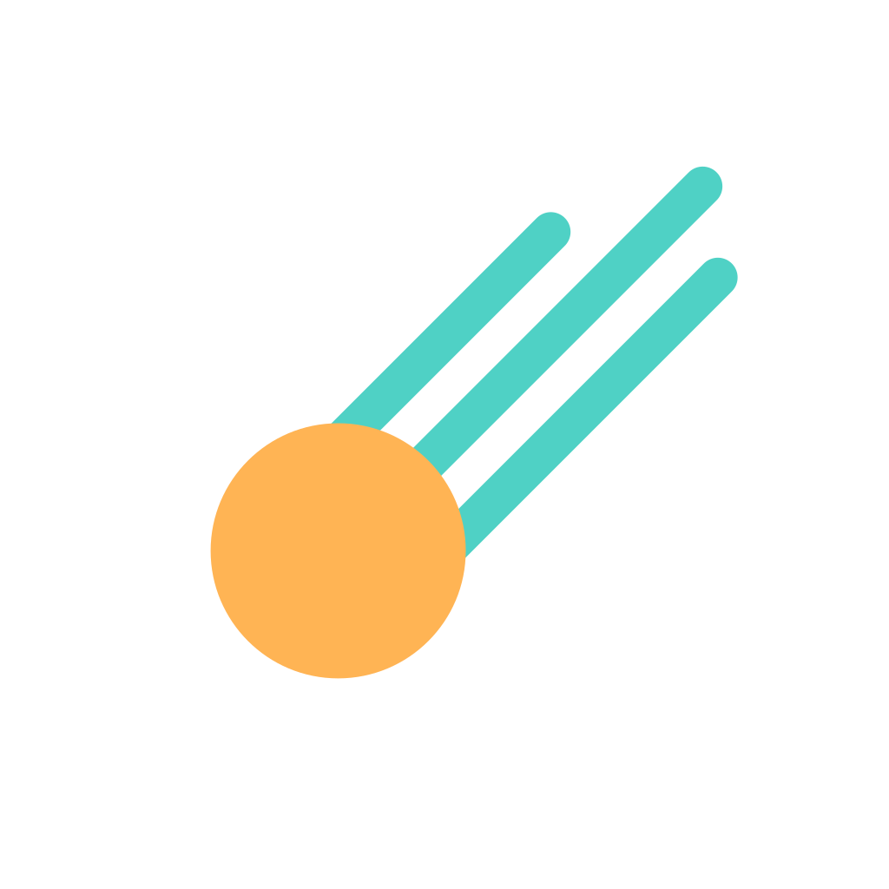

# COMET

**Coordinated Opponents, Movement & Engagement Tactics**

Bots that flank you, approach quietly, work together and change tactics during a fight. COMET expands combat for **PMCs and AI Player Scavs**, building on the original **SAIN**.

**Beta 1** - playable development build, still being tested and improved.

## What it does

- **Combat decisions:** hold an angle, push, search or retreat as the fight changes.
- **Movement:** peek corners, move between cover and approach quietly.
- **Squad tactics:** support teammates, find different angles and coordinate pushes.
- **Doors:** watch entrances, feint, ambush and clear rooms.
- **Weapons and gear:** manage reloads, weapon swaps, flashlights and tactical devices.
- **Grenades:** choose and throw grenades, react to threats and avoid hitting squadmates.
- **Survival:** choose when to heal, perform surgery and recover.
- **Raid Review integration:** see what bots chose, why, and what actually happened.

Ordinary scavs, bosses and human players keep their usual behavior. COMET keeps your SAIN preset and personalities.

## Install and configure

1. Use **SPT 4.1.6** with **original SAIN 4.5.1** and SAIN's dependencies. Modified SAIN builds are not supported.
2. Copy the COMET build's `BepInEx` and `SPT_Runtime` folders into your SPT folder.
3. Start the server and open [COMET settings](https://127.0.0.1:6969/comet).

Choose **Easy, Normal or Hard** (default), explore the features and save your own presets. Changes apply next raid. These levels adjust COMET, leaving your SAIN preset unchanged.

**ORBIT is optional.** COMET can also run with Questing Bots + Looting Bots. Use one setup or the other. Raid Review is optional and needs a build with COMET support.

Fika support is included in the same ZIP but hasn't been tested in multiplayer yet. Use matching COMET builds on the AI host/headless and playing clients, with the server files on your SPT server. The Fika component stays inactive in solo.

For bug reports, keep **Diagnostics > Quiet logging OFF** and include the files from `BepInEx/COMET/diagnostics`. Quiet reduces local logs without removing Raid Review events.

## Credits

**This mod would not exist without R_F's work.** Most of its combat features come from his SAIN zzap work, ported with his permission into a separate mod that requires SAIN, with my tweaks and additions. His developer kit also helped with testing.

Thanks to **Solarint and the SAIN contributors** for the foundation, and everyone testing and reporting bugs.

## AI disclosure, pitchfork edition

**100% AI-generated code.** Very human testing, debugging and evenings spent wondering why a bot is staring at a door.

AI haters: this mod isn't for you. Bye!

Don't try to read the code: it's optimized for LLMs and saving tokens, not human eyes. At least, that's my excuse.

Jokes aside, bug reports and PRs are welcome. Please leave your pitchfork at the door.

---

[Build from source](BUILDING.md) · [MIT license](LICENSE) · [Attribution](THIRD_PARTY_NOTICES.md)
